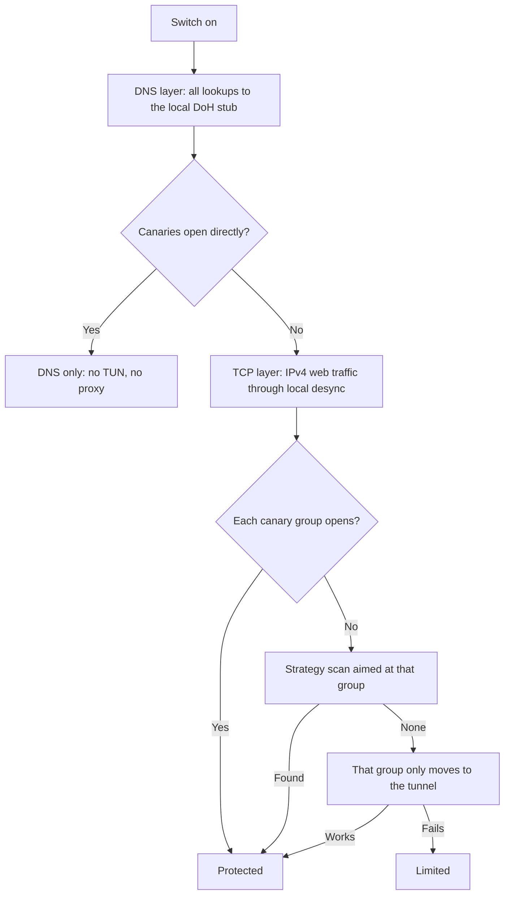

# Network architecture

1.1.0 protects in layers and adds a layer only when the network needs it.
Nothing is sent through a remote tunnel by default.

## Layers

**DNS.** Every lookup goes to the local stub. Upstreams are Google first
(EDNS Client Subnet keeps CDN answers near the user's ISP), then Quad9 and
Cloudflare, raced after 150 ms. Known censorship answers are dropped.

**Measurement.** Core opens a certificate-verified TLS connection to each canary
group's first host and to neutral controls, on the physical interface. A reset,
drop, certificate error or a handshake over three seconds marks filtering.
Controls failing too means no internet, not filtering.

**TCP layer.** Only when filtering is measured. One sing-box process owns the
TUN, which captures public IPv4 only. IPv4 TCP 80/443 goes to ByeDPI. Its first
group leaves the connection alone; ByeDPI applies the strategy only after a
reset, timeout or missing ServerHello and remembers that destination. Unfiltered
sites therefore pay no split/disorder cost. UDP and QUIC stay direct: Turkish
filtering inspects TCP SNI/Host, not QUIC. Exclusions (game stores, OS updates,
banks, government sites) always go direct. While this layer is up, the DNS stub
answers AAAA with NODATA so protected traffic stays on IPv4.

**Tunnel.** Only for a canary group that local desync cannot open. The tunnel
lives in the same gateway behind per-group selectors; switching a group does not
rebuild the adapter. WARP registers over the physical interface; endpoints on
`162.159.192.0/24` and `162.159.193.0/24` are tried across UDP 2408, 500, 1701
and 4500, and the first that passes the control quorum is remembered for that
network. A configured Reality server is used when WARP is not reachable.

## Canary groups

Groups come from the signed ruleset (`ruleset/active.json`, schema 3).
`persistent` groups are filtered on most lines and decide whether the TCP layer
is needed. `crisis` groups are filtered on specific days and are checked every
fifth round. The ruleset can be updated without an app release, including new
ByeDPI candidates; their flags are checked against an allowlist.

## Health and states

The gateway probes each due group every 30 s. Two failed rounds start a scan
that must open the group's canary without breaking the controls. The winner is
verified on the real helper and gateway before it is kept, and cached for the
network's ASN and physical fingerprint. If no strategy works, the group moves to
the tunnel; if the tunnel fails too, the group is unreachable and retried every
ten minutes.

| State | When |
| --- | --- |
| Açık / Protected | All layers up, persistent groups open |
| Sınırlı / Limited | TCP layer could not start (DNS stays on), or a persistent group opens on no path |
| Bağlantı yok / No connection | Controls fail on the physical interface |
| Yeniden bağlanıyor / Reconnecting | A component restarts or a heal is running |
| Bozuldu / Broken | DNS stub stopped, or recovery gave up |

## Startup and recovery

Before the gateway starts, core removes a stale `offveil` adapter, then waits up
to 20 s for the new one while watching the gateway process. If the TCP layer
fails, protection stays on with DNS only and retries the layer three times,
two minutes apart. A network change on the same interface restarts only the
helper with the new source address and re-measures; a different interface
rebuilds the stack.

## Validation

Unit tests cover the generated gateway (no full-tunnel route, exclusion order,
selector defaults, IPv4-only capture), the pass-through chain, ruleset limits,
classification, group escalation, fallback and the update channels. Native
tests run `sing-box check` on every configuration and switch selectors on a live
gateway without TUN. TUN traffic, MTU and cleanup need a physical device on the
affected ISP; see the beta checklist in [releases](releases.md).
