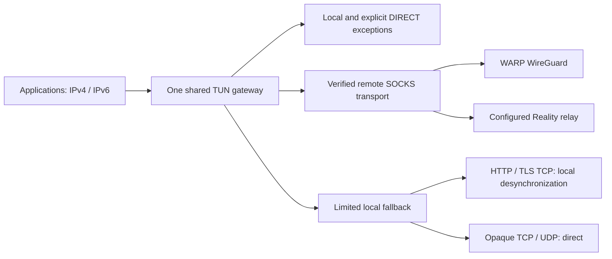

# General network architecture

Version 1.0.4-beta.4 routes public network traffic by transport capability.
It contains no built-in application list, process-name matching, guessed CDN
siblings or application-specific startup checks. Published beta.3 installers
predate this change.

## Routing and ownership

The core owns DNS, the physical egress snapshot, the optional local helper and
the network session. A network session owns one gateway/TUN process and at most
one remote provider process. Provider candidates use a separate loopback SOCKS
listener with TUN disabled. Provider rejection cannot leave behind a new adapter.
Remote-to-remote failover keeps the gateway. A local-to-remote promotion verifies
the remote candidate before replacing the gateway; failed preflight leaves the
working local path alone. A failed gateway promotion restores the local gateway.

Remote mode forwards public TCP and UDP over the verified provider. It does not
require DNS, TLS SNI, an executable name or a known application port. This covers
legacy opaque protocols, literal-IP destinations and QUIC as well as HTTPS.
Private/local destinations, bootstrap reachability and explicit user DIRECT
exceptions remain direct. IPv4 and IPv6 split-default routes and owned-subnet
loop guards are generated together. Physical egress binding prevents the relay
from re-entering its own capture path.

If no remote provider passes, local mode attempts HTTP/TLS desynchronization
and uses protocol-based QUIC rejection to encourage TCP fallback. Other TCP/UDP
traffic remains direct. This is reported as limited protection, not as an
encrypted full network tunnel. Local desynchronization cannot replace a relay
for an IP block or an arbitrary legacy protocol. No architecture can provide an
unreachable relay: a reachable configured provider is required for that coverage.

The source-bound local helper currently supports IPv4. Local IPv6 traffic remains
direct instead of entering an incompatible address family. Diagnostics report
`bypass_families` separately from capture configuration. Remote mode covers both
families. This follows the helper's [socket-family contract](https://github.com/hufrea/byedpi/blob/v0.17.3/proxy.c).

## Independent health boundaries

- **Process health:** DNS listener, gateway and provider processes are alive.
  The local helper is required for local mode and optional in remote mode.
- **Transport health:** certificate-verified TLS checks to three independently
  configured neutral control hosts; at least two must pass. Remote controls
  run through both the provider listener and the gateway. Provider-only control
  routing cannot inherit user DIRECT exceptions or bootstrap bypass rules.
- **Endpoint diagnostics:** an explicitly requested site's DNS/TCP/TLS/HTTP
  result. It is evidence about that endpoint, and never changes the selected
  network route or the global health decision.
- **Coverage:** remote public TCP/UDP with dual-stack capture, or limited local
  HTTP/TLS bypass. A successful TLS handshake never upgrades local UDP coverage.

Two failed control rounds are needed before degrading an accepted remote path.
A single failed site or control host does not suppress checks for other hosts.
Background work runs outside the lifecycle lock, belongs to one cancellable
session and discards results after Stop or session replacement. Provider retries
are bounded and separated by a cooldown. DNS observations only count bounded
demand; raw browsing hostnames are not exported and never cause speculative
probes or guessed routes.

Local strategy discovery uses the same independent-control quorum. Trials keep
the accepted helper alive. A winner is verified on the real helper and gateway
before adoption; failed verification restores the accepted helper. The strategy
cache is scoped to network identity and transport profile using a new namespace;
old application/ASN-only evidence cannot pin a global strategy.

## Configuration migration

The source and embedded rulesets use schema 2 and ruleset version 7. The default
contains only network control hosts. Optional DIRECT exceptions distinguish exact
domains from suffixes. Unsupported route paths and nonempty legacy packages are
rejected instead of being accepted as ineffective metadata. Old cached, adjacent
or signed remote application rules cannot reactivate application-specific logic.
Remote/cache updates still require Ed25519 verification. Release CI produces a
fresh signature for the new source ruleset; the obsolete v6 signature is removed.

IPC retains its envelopes and adds `status.network`. `targets` reports generic
TCP/UDP capability rather than application cards. Current clients distinguish
limited fallback from a failed required component. Detailed support exports use
`system.network_connectivity`; see [network diagnostics](network-diagnostics.md).

## Validation and physical acceptance

Unit/regression coverage must include:

- one unavailable control versus loss of quorum;
- endpoint diagnostic failure without a routing or policy change;
- optional helper failure while remote TCP/UDP remains healthy;
- required gateway failure taking precedence over optional helper failure;
- provider trial and failed upgrade without TUN churn;
- exact versus suffix DIRECT exceptions and exception-free transport controls;
- rollback after candidate or real-port verification failure;
- Stop/replacement during probes, discovery and provider refresh;
- replacement DNS cleanup and failed-start diagnostics after a prior session;
- IPv4/IPv6 routes, exclusions, native opaque TCP/UDP and DNS forwarding.

Native fixtures launch SOCKS-only configurations. TUN-bearing configurations are
validated with `sing-box check`; fixtures must not create adapters or modify host
DNS/routes. Cross-compilation verifies build compatibility, not routed traffic.

Before stable release, test a disposable Windows/macOS device on the affected ISP and a
hotspot: opaque TCP on non-web ports, public-IP UDP, TLS/HTTP, QUIC, IPv4/IPv6,
provider outage/recovery, sleep/wake and Stop/repair. Confirm actual TUN traffic,
cleanup and effective interface MTU. A SOCKS fixture alone does not establish
that the affected customer's routed application session works.

Implementation follows the pinned [sing-box TUN contract](https://github.com/SagerNet/sing-box/blob/v1.13.14/docs/configuration/inbound/tun.md)
and [route actions](https://github.com/SagerNet/sing-box/blob/v1.13.14/docs/configuration/route/rule_action.md).
Provider bootstrap and data-plane reachability are separate boundaries, as in
[Cloudflare's firewall requirements](https://developers.cloudflare.com/cloudflare-one/connections/connect-devices/warp/deployment/firewall/).

## Local verification — 21 October 2026

- Full core suite with the pinned native sing-box fixtures and `go vet ./...`: passed.
- Race checks for engine, desync, tunnel, DNS, support, process, capture, IPC and service: passed.
- Native opaque TCP over IPv4/IPv6 loopback peers, opaque UDP, DNS forwarding and four configuration variants: passed.
- Packet-level mixed/gVisor UDP reassembly at 64–4096 bytes in normal/reversed fragment order: passed.
- Windows amd64 and macOS arm64 core builds: passed; macOS result is compilation only.
- UI production build, 22 Node tests, 32 Rust tests and changed Rust formatting: passed.
- React Doctor changed-source scan: no issues reported (85/100).

The packet test module now includes the required Windows capture dependency
checksums. These results do not replace actual OS/TUN and affected-ISP acceptance.
The general remote path also changes latency and bandwidth according to the
chosen provider; no affected-line performance benchmark has been performed.
